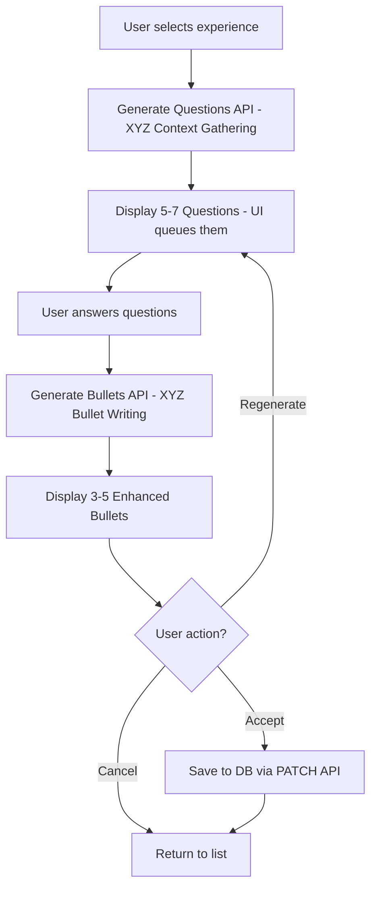

# Deep Achievement Enhancement - Technical Design

## Context

Users need a way to systematically enhance their work experience achievements after profile creation by providing additional context through AI-guided questioning. This feature is separate from the light polish feature (which enhances during onboarding) and provides a more thorough, conversational enhancement experience.

## Goals

- Provide dedicated enhancement page accessible post-profile-creation
- Generate contextual questions based on achievement analysis
- Support conversational flow with follow-up questions
- Allow users to enhance one experience at a time or all experiences in sequence
- Store answers temporarily for regeneration within the same session
- Track enhancement status with timestamps
- Maintain user control with preview, accept, and regenerate options

## Non-Goals

- Storing enhancement history or audit trails (only store final enhanced text)
- Persisting user answers between sessions (answers cleared after acceptance)
- Providing undo/revert functionality after acceptance
- Integrating deep enhancement into onboarding flow (separate feature)

## Architecture

### Frontend Architecture

```
/profile/enhance (Enhancement Page)
├── Experience List View
│   ├── Experience Card (company, title, dates, status)
│   ├── Enhancement Status Badge (Not Enhanced / Enhanced on [date])
│   └── Enhance Button
│
└── Enhancement Flow (Modal or Dedicated View)
    ├── Step 1: Question Generation
    │   ├── Loading state
    │   └── Error handling with retry
    │
    ├── Step 2: Question Answering
    │   ├── Question display (one at a time or all at once)
    │   ├── Text input fields
    │   ├── Skip question option
    │   └── Submit answers button
    │
    ├── Step 3: Follow-up Questions (if needed)
    │   ├── Additional questions based on answers
    │   ├── Option to skip to enhancement
    │   └── Submit follow-ups button
    │
    └── Step 4: Preview & Accept
        ├── Original vs Enhanced comparison
        ├── Accept button (saves to DB)
        ├── Regenerate button (returns to Step 2 with pre-filled answers)
        └── Cancel button (returns to experience list)
```

### Backend Architecture

```
API Endpoints:
├── POST /api/career-id/enhancement/generate-questions
│   ├── Input: { experienceId, experience object }
│   ├── Output: { questions: [{ id, text }] }
│   ├── Uses XYZ Method Context Gathering Prompt
│   └── AI analyzes achievements, generates 5-7 targeted questions
│
├── POST /api/career-id/enhancement/generate-bullets
│   ├── Input: { experienceId, experience object, answers: [{ questionId, answer }] }
│   ├── Output: { bullets: string[] }
│   ├── Uses XYZ Method Bullet Writing Prompt
│   └── AI generates 3-5 XYZ-format achievement bullets
│
└── PATCH /api/career-id/profile/:profileId/experience/:id
    ├── Existing endpoint - used to save enhanced achievements
    └── Updates highlights array and last_enhanced_at timestamp
```

**XYZ Method Prompts:**
- **Context Gathering Prompt** ([`deliverables/prompts/context-gathering-prompt.md`](deliverables/prompts/context-gathering-prompt.md))
  - Generates 5-7 targeted questions based on employment type
  - Focuses on extracting X (achievement), Y (metrics), Z (methods)
  - Tailors questions to employment type (full-time, part-time, contract, internship)
  
- **Bullet Writing Prompt** ([`deliverables/prompts/bullet-writing-prompt.md`](deliverables/prompts/bullet-writing-prompt.md))
  - Generates 3-5 XYZ-format bullets from user answers
  - Uses employment-type-appropriate action verbs
  - Ensures every bullet has quantifiable metrics
  - Maintains 1-2 line length for scannability

### Data Flow



**Key Workflow Changes:**
- **Single-pass question generation:** All 5-7 questions returned at once (no follow-ups)
- **UI handles queueing:** Frontend displays questions one at a time or all at once
- **Two-prompt system:** Separate prompts for question generation and bullet writing
- **XYZ Method:** All bullets follow "Accomplished [X] as measured by [Y] by doing [Z]" formula

## Decisions

### Decision 1: Two-Prompt XYZ Method Workflow

**Choice:** Two separate API calls with distinct prompts (question generation → bullet writing)

**Rationale:**
- **Prompt 1 (Context Gathering):** Generates 5-7 targeted questions to extract X, Y, Z components
- **Prompt 2 (Bullet Writing):** Generates 3-5 XYZ-format bullets from user answers
- Separates concerns: question quality vs bullet quality
- Allows independent optimization of each prompt
- All questions returned at once (UI handles display/queueing)
- No follow-up questions needed - comprehensive initial questions

**Alternatives Considered:**
- Single prompt for both - Rejected: Less focused, harder to optimize
- Conversational flow with follow-ups - Rejected: More complex, user fatigue
- Streaming approach - Rejected: Unnecessary complexity for this use case

### Decision 2: Answer Storage Strategy

**Choice:** Store answers in component state, clear after acceptance

**Rationale:**
- Answers only needed for regeneration within the same enhancement session
- No business value in persisting answers long-term
- Reduces database complexity and storage requirements
- Users can re-enhance with fresh questions if they want to update later

**Alternatives Considered:**
- Store answers in database - Rejected: Unnecessary complexity, no clear use case
- Store answers in localStorage - Rejected: Could persist stale data across sessions

### Decision 3: Database Schema Changes

**Choice:** Add `last_enhanced_at` timestamp column to `career_id.experience` table

**Rationale:**
- Minimal schema change (single nullable column)
- Enables enhancement status tracking
- Allows sorting/filtering by enhancement status
- No need for separate enhancement history table

**SQL Migration:**
```sql
ALTER TABLE career_id.experience 
ADD COLUMN last_enhanced_at TIMESTAMPTZ;

COMMENT ON COLUMN career_id.experience.last_enhanced_at IS 
'Timestamp of last deep enhancement (NULL if never enhanced)';
```

**Alternatives Considered:**
- Separate enhancement_history table - Rejected: Over-engineered for current needs
- Boolean `is_enhanced` flag - Rejected: Loses temporal information

### Decision 4: Enhancement Page vs Modal

**Choice:** Dedicated page at `/profile/enhance` with modal for enhancement flow

**Rationale:**
- Dedicated page provides clear entry point and focused experience
- Modal for enhancement flow keeps context visible (experience list in background)
- Allows deep linking to enhancement page
- Separates enhancement from profile dashboard (different mental models)

**Alternatives Considered:**
- Modal from profile dashboard - Rejected: Clutters dashboard, harder to navigate
- Inline enhancement on profile page - Rejected: Too much UI complexity on one page

### Decision 5: Bulk Enhancement Flow

**Choice:** Sequential enhancement with progress tracking

**Rationale:**
- Users can enhance all experiences in one session
- Each experience enhanced individually (maintains quality)
- Progress saved after each acceptance (no data loss)
- User can cancel at any time

**Implementation:**
- "Enhance All" button on enhancement page
- After accepting one experience, automatically start next
- Show progress indicator (e.g., "2 of 5 experiences enhanced")
- Allow skip to next experience

## Risks / Trade-offs

### Risk 1: AI Question Quality

**Risk:** AI may generate irrelevant or repetitive questions

**Mitigation:**
- Carefully crafted system prompts with examples
- Limit to 3-5 questions per round
- Allow users to skip questions
- Test with diverse achievement examples

### Risk 2: Enhancement Timeout

**Risk:** AI processing may take too long, causing poor UX

**Mitigation:**
- Set reasonable timeouts (15s for questions, 20s for enhancement)
- Display clear loading states with progress messages
- Provide retry functionality
- Cache questions if possible

### Risk 3: User Abandonment

**Risk:** Multi-step flow may be too complex, users abandon mid-enhancement

**Mitigation:**
- Save progress after each step
- Allow users to resume where they left off
- Provide clear progress indicators
- Make enhancement optional (not required)

### Risk 4: Answer Quality

**Risk:** Users may provide vague or insufficient answers

**Mitigation:**
- AI can ask follow-up questions for clarification
- Provide examples in question prompts
- Allow users to skip and still get some enhancement
- Don't block enhancement if answers are incomplete

## Migration Plan

### Phase 1: Database Migration
1. Add `last_enhanced_at` column to `career_id.experience` table
2. Run migration on development environment
3. Verify column added successfully
4. Deploy to production (non-breaking change)

### Phase 2: Backend Implementation
1. Create `server/utils/deep-enhancer.ts` utility
2. Implement question generation logic
3. Implement answer processing and follow-up logic
4. Create API endpoints
5. Add comprehensive error handling
6. Test with various experience examples

### Phase 3: Frontend Implementation
1. Create enhancement page at `/profile/enhance`
2. Build experience list view with status indicators
3. Implement enhancement flow modal/wizard
4. Add question answering UI
5. Build preview and accept/regenerate UI
6. Integrate with store actions
7. Add navigation links from profile dashboard

### Phase 4: Testing & Refinement
1. Test full enhancement flow end-to-end
2. Test error scenarios (timeouts, API failures)
3. Test bulk enhancement flow
4. Gather user feedback
5. Refine AI prompts based on results
6. Optimize performance

### Rollback Plan
- Database migration is additive (can be rolled back by dropping column)
- Feature is opt-in (users can ignore enhancement page)
- No breaking changes to existing profile functionality
- Can disable feature by removing navigation links

## Open Questions

1. **Question Format:** Should questions be multiple choice, free text, or a mix?
   - **Recommendation:** Start with free text for flexibility, add structured inputs later if needed

2. **Enhancement Scope:** Should we support enhancing education and certifications too?
   - **Recommendation:** Start with work experience only, expand later based on user demand

3. **AI Model:** Should we use GPT-4o or GPT-4o-mini for enhancement?
   - **Recommendation:** Use GPT-4o for better quality, fall back to GPT-4o-mini if cost is concern

4. **Question Limit:** What's the maximum number of questions per experience?
   - **Recommendation:** 3-5 initial questions, 2-3 follow-ups max (total 8 questions max)

5. **Enhancement Indicators:** Should we show enhancement status on generated resumes?
   - **Recommendation:** No - enhanced achievements are the new baseline, no need to indicate
