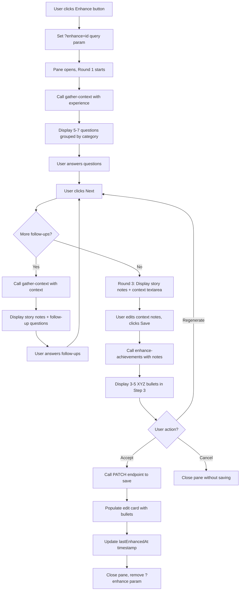

# Deep Achievement Enhancement - Technical Design

## Context

Users need a way to systematically enhance their work experience achievements after profile creation by providing additional context through AI-guided questioning. This feature is separate from the light polish feature (which enhances during onboarding) and provides a more thorough, conversational enhancement experience.

## Goals

- Provide dedicated enhancement page accessible post-profile-creation
- Generate contextual questions based on achievement analysis
- Support conversational flow with follow-up questions
- Allow users to enhance one experience at a time or all experiences in sequence
- Store answers temporarily for regeneration within the same session
- Track enhancement status with timestamps
- Maintain user control with preview, accept, and regenerate options

## Non-Goals

- Storing enhancement history or audit trails (only store final enhanced text)
- Persisting user answers between sessions (answers cleared after acceptance)
- Providing undo/revert functionality after acceptance
- Integrating deep enhancement into onboarding flow (separate feature)

## Architecture

### Frontend Architecture

The enhancement flow is integrated into the experience page with a 50% slide-out pane:

```
/profile/experience (Modified Page)
├── Experience List (left side, 50% width when pane open)
│   ├── Experience Cards
│   │   ├── View Mode
│   │   │   ├── Edit Button
│   │   │   └── Enhance Button (NEW)
│   │   └── Edit Mode (existing)
│   │       └── Enhance Button (NEW)
│   └── Active Card Highlight (when ?enhance=<id> param set)
│
└── Enhancement Pane (right side, 50% width, triggered by ?enhance param)
    ├── Round 1: Initial Questions
    │   ├── Loading state
    │   ├── Question groups (5-7 questions)
    │   └── Answer textarea inputs
    │
    ├── Round 2: Follow-up Questions (if any)
    │   ├── Read-only story notes from Round 1
    │   ├── New follow-up questions
    │   └── Answer textarea inputs
    │
    └── Round 3: Context Review & Save
        ├── Read-only accumulated story notes
        ├── Editable context notes textarea
        ├── Generated XYZ bullets preview (3-5 pairs)
        └── Save/Cancel buttons
```

**Component Hierarchy:**
```
experience.vue
├── ExperienceList (existing, modified for highlight)
│   └── ExperienceCard (modified with Enhance button)
│
└── EnhancementPane (NEW, conditional based on ?enhance param)
    ├── EnhancementStep1 (Round 1)
    ├── EnhancementStep2 (Round 2)
    └── EnhancementStep3 (Round 3)
```

**Key UX Features:**
- Pane triggered by `?enhance=<experienceId>` query parameter
- Active experience card highlighted when pane is open
- 50% width pane on desktop, full-width on mobile
- Smooth slide-in animation from right
- Three-round conversational flow (no dedicated page needed)

### Backend Architecture

```
API Endpoints:
├── POST /api/career-id/profile/[profileId]/experience/[id]/gather-context
│   ├── Input: { experience: Experience, context?: ContextObject }
│   ├── Output: { success: true, data: { questionGroups: QuestionGroup[], notes: StoryNote[] } }
│   ├── Uses XYZ Method Context Gathering Prompt
│   ├── Round 1: Generates 5-7 initial questions (no context)
│   └── Round 2+: Generates follow-up questions based on previous answers and story notes
│
├── POST /api/career-id/profile/[profileId]/experience/[id]/enhance-achievements
│   ├── Input: { experience: Experience, notes: StoryNote[] }
│   ├── Output: { success: true, data: { bullets: BulletPair[] } }
│   ├── Uses XYZ Method Bullet Writing Prompt
│   └── Final step: Generates 3-5 XYZ-format bullet pairs from accumulated story notes
│
└── PATCH /api/career-id/profile/:profileId/experience/:id (existing endpoint)
    ├── Extended to accept: { highlights?: string[], contextNotes?: string, lastEnhancedAt?: timestamp }
    ├── Updates experience with enhanced achievements and context notes
    └── Sets lastEnhancedAt timestamp on save
```

**XYZ Method Prompts:**
- **Context Gathering Prompt** ([`deliverables/prompts/context-gathering-prompt.md`](deliverables/prompts/context-gathering-prompt.md))
  - Generates 5-7 targeted questions based on employment type
  - Focuses on extracting X (achievement), Y (metrics), Z (methods)
  - Tailors questions to employment type (full-time, part-time, contract, internship)
  - Returns questionGroups organized by category for better presentation
  
- **Bullet Writing Prompt** ([`deliverables/prompts/bullet-writing-prompt.md`](deliverables/prompts/bullet-writing-prompt.md))
  - Generates 3-5 XYZ-format bullets from accumulated story notes
  - Uses employment-type-appropriate action verbs
  - Ensures every bullet has quantifiable metrics
  - Returns primary/secondary bullet pairs for user choice

### Data Flow



**Three-Round Flow:**

1. **Round 1: Initial Questions**
   - Call `gather-context(experience)` with no context
   - Display 5-7 questions organized by category
   - User answers (at least one required)
   - Store answers in component state
   - Generate story notes from answers (returned by API)

2. **Round 2: Follow-up Questions** (repeat if follow-ups exist)
   - Display story notes from previous round (read-only)
   - Call `gather-context(experience, context)` with answered questions
   - If no follow-up questions returned, skip to Round 3
   - If follow-ups exist, display them grouped by category
   - User answers follow-ups (optional, can skip round)
   - Append new answers and notes to context state

3. **Round 3: Context Review & Save**
   - Display accumulated story notes (read-only)
   - Show editable context notes textarea for user to add context
   - Call `enhance-achievements(experience, contextNotes)` to generate final bullets
   - Display 3-5 XYZ bullets with X/Y/Z highlighting
   - User accepts (saves to DB) or regenerates (returns to Round 1 with context preserved)

**Key Workflow Changes from Original Design:**
- **Multi-round with context accumulation:** Rounds 1-2 focus on context gathering with follow-ups; Round 3 focuses on refinement
- **Story notes accumulate:** Each round adds to story notes (shown in next round as context)
- **Context notes persist:** Stored in database for future reference and regenerations
- **Query param driven:** Pane opens/closes with `?enhance=<id>`, keeps user in experience list context

## Decisions

### Decision 1: Two-Prompt XYZ Method Workflow

**Choice:** Two separate API calls with distinct prompts (question generation → bullet writing)

**Rationale:**
- **Prompt 1 (Context Gathering):** Generates 5-7 targeted questions to extract X, Y, Z components
- **Prompt 2 (Bullet Writing):** Generates 3-5 XYZ-format bullets from user answers
- Separates concerns: question quality vs bullet quality
- Allows independent optimization of each prompt
- All questions returned at once (UI handles display/queueing)
- No follow-up questions needed - comprehensive initial questions

**Alternatives Considered:**
- Single prompt for both - Rejected: Less focused, harder to optimize
- Conversational flow with follow-ups - Rejected: More complex, user fatigue
- Streaming approach - Rejected: Unnecessary complexity for this use case

### Decision 2: Answer Storage & Context Persistence

**Choice:** Store answers in component state during session; persist context notes to database

**Rationale:**
- Answers only needed for regeneration within the same enhancement session
- Context notes (accumulated story understanding) have long-term value for future regenerations
- Database persistence enables users to regenerate with fresh questions but same context
- Reduces complexity of managing session data while preserving valuable context

**Alternatives Considered:**
- Store all answers in database - Rejected: Excessive storage, no clear value after session
- Store all in component state - Rejected: Loses valuable context accumulation for future use
- Store answers in localStorage - Rejected: Could persist stale data across sessions

### Decision 3: Database Schema Changes

**Choice:** Add `last_enhanced_at` timestamp and `context_notes` text columns to `career_id.experience` table

**Rationale:**
- Minimal schema change (two nullable columns)
- Enables enhancement status tracking and temporal information
- Context notes allow users to preserve interview understanding for future regenerations
- Allows sorting/filtering by enhancement status
- No need for separate enhancement history table

**SQL Migration:**
```sql
ALTER TABLE career_id.experience 
ADD COLUMN last_enhanced_at TIMESTAMPTZ,
ADD COLUMN context_notes TEXT;

COMMENT ON COLUMN career_id.experience.last_enhanced_at IS 
'Timestamp of last deep enhancement (NULL if never enhanced)';

COMMENT ON COLUMN career_id.experience.context_notes IS 
'User-provided context from enhancement flow (preserved for regenerations)';
```

**Alternatives Considered:**
- Separate enhancement_history table - Rejected: Over-engineered for current needs
- Boolean `is_enhanced` flag - Rejected: Loses temporal information
- Store context_notes in separate table - Rejected: Added complexity without benefit

### Decision 4: Pane Integration vs Dedicated Page

**Choice:** Integrate 50% slide-out pane into `/profile/experience` page, triggered by `?enhance=<id>` query parameter

**Rationale:**
- Keeps user in context (can see experience list while enhancing)
- Query param is cleaner than dedicated page navigation
- 50% pane allows side-by-side comparison of experience and enhancement flow
- Mobile responsive (full-width pane on mobile, 50% on desktop)
- Single URL for both list and enhancement (simpler routing)
- Active card highlighting provides clear visual feedback

**Alternatives Considered:**
- Dedicated `/profile/enhance` page - Rejected: Loses context of experience list, requires page navigation
- Full-screen modal - Rejected: Blocks view of other experiences
- Inline enhancement on card - Rejected: Too much UI complexity on card itself

### Decision 5: Multi-Round Context Gathering vs Single Pass

**Choice:** Three-round flow with follow-up questions and context accumulation

**Rationale:**
- Round 1: Generates targeted initial questions (5-7 questions)
- Round 2+: Generates follow-up questions based on Round 1 answers, accumulates story notes
- Round 3: Allows user to edit context notes before final bullet generation
- Follow-ups enable deeper context extraction without overwhelming initial prompt
- Context accumulation (story notes) improves final bullet quality
- Users can see progress through rounds with clear step indicators

**Implementation:**
- Store answers + story notes across rounds in component state
- Auto-advance from Round 2 if no follow-up questions exist
- Display accumulated story notes at each round for user review
- Allow Back button for round navigation (except Round 1)
- Context notes editable in Round 3 only (final refinement)

**Alternatives Considered:**
- Single-pass with all questions at once - Rejected: Less focused, harder to extract deep context
- Conversational chatbot flow - Rejected: More complex UI, unclear when done
- Bulk "Enhance All" - Rejected: Each experience needs iterative user input

## Risks / Trade-offs

### Risk 1: Multi-Round Fatigue

**Risk:** Users may abandon after Round 1 or 2, losing accumulated context

**Mitigation:**
- Clear progress indicators showing round number (e.g., "Round 2 of 3")
- Display accumulated story notes at each round to show progress
- Allow skip to final step (or back navigation)
- Keep questions focused and concise (5-7 max per round)
- Show estimated time to completion

### Risk 2: AI Question Quality

**Risk:** AI may generate irrelevant or repetitive questions

**Mitigation:**
- Carefully crafted system prompts with employment type tailoring
- Test with diverse achievement examples
- Allow users to skip questions
- Gather feedback and refine prompts iteratively

### Risk 3: Enhancement Timeout

**Risk:** AI processing may take too long, causing poor UX

**Mitigation:**
- Set reasonable timeouts (30s for questions, 20s for bullets per task)
- Display clear loading states with progress messages
- Provide retry functionality
- Implement debouncing for input handling

### Risk 4: Context Notes Quality

**Risk:** Users may provide vague context notes, reducing bullet quality

**Mitigation:**
- Provide clear placeholder text with examples
- Show story notes above context textarea as reference
- Allow regeneration to try again with better context
- Validate that at least one story note exists before allowing save

### Risk 5: Query Parameter Loss

**Risk:** User navigates away and loses ?enhance param, losing pane state

**Mitigation:**
- Store enhancement state in store (not just component)
- Warn user if trying to close pane with unsaved answers
- Allow browser back button to restore pane state via query param

## Migration Plan

### Phase 1: Database Migration
1. Add `last_enhanced_at` and `context_notes` columns to `career_id.experience` table
2. Run migration on development environment
3. Verify columns added successfully
4. Deploy to production (non-breaking change)

### Phase 2: Backend Implementation
1. Create `server/utils/profile-experience-enhancer.ts` utility
2. Implement `generateXYZQuestions()` function with multi-round support
3. Implement `generateXYZBullets()` function
4. Create `/gather-context` endpoint for question generation
5. Create `/enhance-achievements` endpoint for bullet generation
6. Add comprehensive error handling
7. Test with various experience examples and employment types

### Phase 3: Frontend Implementation
1. Create enhancement types in `shared/types/enhancement.ts`
2. Update `careerId.ts` type definitions
3. Update store (`careerIDStore.ts`) with multi-round enhancement state
4. Modify `experience.vue` for query param handling and pane rendering
5. Create `EnhancementPane.vue` with step navigation
6. Create `EnhancementStep1.vue`, `EnhancementStep2.vue`, `EnhancementStep3.vue`
7. Add "Enhance" buttons to experience cards (view and edit modes)
8. Update profile dashboard with enhancement status badge
9. Add navigation links from profile dashboard

### Phase 4: Testing & Refinement
1. Test full 3-round enhancement flow end-to-end
2. Test query parameter handling (`?enhance=<id>`)
3. Test error scenarios (timeouts, API failures, network errors)
4. Test multi-round context accumulation
5. Test mobile responsiveness (full-width pane)
6. Gather user feedback
7. Refine AI prompts based on results
8. Optimize performance

### Phase 5: Deployment
1. Deploy database migration to production
2. Deploy backend endpoints
3. Deploy frontend components
4. Monitor for errors and performance issues
5. Gather user feedback and iterate

### Rollback Plan
- Database migration is additive (can be rolled back by dropping columns)
- Feature is opt-in (users must click "Enhance" button to trigger pane)
- No breaking changes to existing profile functionality
- Can disable feature by removing query param handling and "Enhance" buttons

## Open Questions

1. **Context Notes Examples:** What examples should we show for context notes textarea?
   - **Recommendation:** Show examples like "Led team of 5", "Reduced costs by 30%", "Improved performance 5x"

2. **Mobile Pane Behavior:** Should pane be full-width on mobile or stacked vertically?
   - **Recommendation:** Full-width on mobile (easier interaction), 50% on desktop

3. **Round Limit:** What's the maximum number of rounds allowed?
   - **Recommendation:** 3-4 rounds max (Round 1: initial, Round 2-3: follow-ups, Final: review)

4. **Skip to Final:** Should users be able to skip rounds and jump directly to final?
   - **Recommendation:** Allow skip from Round 2 if questions are too similar, but not from Round 1

5. **Context Notes Persistence:** Should context notes be visible in experience edit view?
   - **Recommendation:** Show in an info tooltip or separate section (not inline, to avoid clutter)
