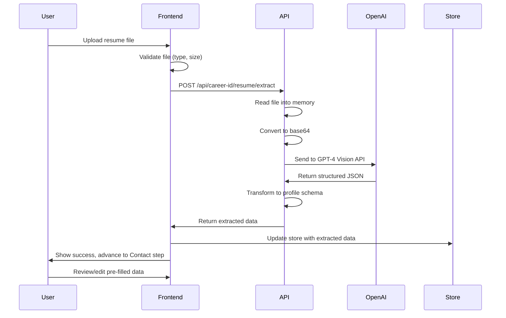

# Design: Resume Upload and AI Extraction

## Context

Users need a faster way to populate their Career ID Profile during onboarding. Manual data entry takes 15-20 minutes and creates friction. Most users already have resumes containing this information. By adding AI-powered resume extraction, we can reduce onboarding time to 2-3 minutes while maintaining data quality.

**Constraints:**
- Must integrate with existing onboarding stepper flow
- Must work with existing database schema (no schema changes)
- Must handle multiple file formats (PDF, DOCX, DOC, JPG, PNG)
- Must achieve 85%+ extraction accuracy on standard resumes
- Must not persist uploaded files (privacy/security requirement)
- Must gracefully handle extraction failures

**Stakeholders:**
- End users (job seekers)
- Product team (conversion metrics)
- Engineering team (implementation and maintenance)

## Goals / Non-Goals

### Goals
- Reduce onboarding time from 15-20 minutes to 2-3 minutes
- Achieve 85%+ extraction accuracy on standard resume formats
- Support common resume file formats (PDF, DOCX, DOC, JPG, PNG)
- Provide clear feedback during extraction process
- Allow users to review and correct extracted data
- Maintain existing data validation and quality standards
- Ensure secure handling of PII in resume files

### Non-Goals
- Handwritten resume processing
- Non-English resume support (future enhancement)
- Creative/non-standard resume format support
- Resume file storage or management
- Bulk resume processing
- Real-time resume updates from external sources
- Resume generation or formatting features

## Decisions

### Decision 1: OpenAI GPT-4 Vision API for Extraction

**What:** Use OpenAI GPT-4 Vision API with structured output for resume parsing

**Why:**
- Handles both text-based (PDF, DOCX) and image-based (JPG, PNG) resumes
- Structured output mode ensures consistent JSON responses
- High accuracy on varied resume formats (85%+ achievable)
- Robust handling of different layouts and styles
- No need for separate OCR pipeline

**Alternatives Considered:**
1. **AWS Textract + Custom NLP**
   - Pros: Good OCR, AWS ecosystem integration
   - Cons: Requires additional NLP layer for entity extraction, more complex pipeline
   
2. **Anthropic Claude with Vision**
   - Pros: Similar capabilities to GPT-4 Vision
   - Cons: User specified OpenAI preference, less mature structured output
   
3. **Dedicated Resume Parsing Service (Sovren, Affinda)**
   - Pros: Purpose-built for resumes, high accuracy
   - Cons: Additional vendor dependency, cost, less flexibility

**Implementation:**
```typescript
// Structured output schema for consistent extraction
const extractionSchema = {
  type: "object",
  properties: {
    contactInfo: { /* ... */ },
    experience: { type: "array", items: { /* ... */ } },
    education: { type: "array", items: { /* ... */ } },
    skills: { type: "array", items: { type: "string" } },
    certifications: { type: "array", items: { /* ... */ } }
  }
}
```

### Decision 2: In-Memory File Processing Only

**What:** Process uploaded files entirely in memory, never write to disk

**Why:**
- Resumes contain sensitive PII (names, addresses, phone numbers, work history)
- No need for persistent storage (extraction is one-time operation)
- Simpler architecture (no file cleanup, no storage management)
- Reduces attack surface (no file system vulnerabilities)
- Complies with privacy best practices

**Implementation:**
- Use Nuxt's `readMultipartFormData()` to read file into memory
- Convert to base64 for OpenAI API
- Discard file data after extraction completes
- Maximum file size: 10MB (prevents memory issues)

### Decision 3: Add Upload Step to Existing Stepper

**What:** Insert "Upload" step as first step in onboarding stepper, before "Contact"

**Why:**
- Maintains existing onboarding flow structure
- Users can skip upload and proceed to manual entry
- Extracted data pre-fills subsequent steps
- Minimal disruption to existing code
- Leverages existing stepper navigation

**Flow:**
```
Upload (new) → Contact → Experience → Education → Additional
```

**Alternatives Considered:**
1. **Separate upload page before onboarding**
   - Pros: Complete separation of concerns
   - Cons: Extra navigation step, breaks flow continuity
   
2. **Modal overlay on Contact step**
   - Pros: No stepper changes needed
   - Cons: Awkward UX, modal complexity

### Decision 4: Extraction Response Mapping Strategy

**What:** Map AI extraction response to existing database schema format

**Why:**
- No database schema changes required
- Reuse existing API endpoints for saving data
- Maintain existing validation logic
- Extracted data flows through same pipeline as manual entry

**Mapping Strategy:**
```typescript
// AI extraction returns flexible format
// Transform to match existing schema types
function mapExtractionToProfile(extracted: ExtractionResult): ProfileData {
  return {
    contactInfo: mapContactInfo(extracted.contactInfo),
    experience: extracted.experience.map(mapExperience),
    education: extracted.education.map(mapEducation),
    // ... etc
  }
}
```

### Decision 5: Progressive Enhancement Approach

**What:** Upload feature is optional enhancement, not required for onboarding

**Why:**
- Users without resumes can skip directly to manual entry
- Extraction failures don't block onboarding
- Reduces risk of feature becoming blocker
- Allows gradual rollout and testing

**Implementation:**
- "Skip" button prominently displayed on upload step
- Extraction errors automatically advance to manual entry
- Users can edit extracted data in subsequent steps

## Architecture

### Component Structure

```
┌─────────────────────────────────────────────────────────┐
│ onboarding.vue (Parent)                                 │
│ ┌─────────────────────────────────────────────────────┐ │
│ │ UStepper                                            │ │
│ │ - Upload (new)                                      │ │
│ │ - Contact                                           │ │
│ │ - Experience                                        │ │
│ │ - Education                                         │ │
│ │ - Additional                                        │ │
│ └─────────────────────────────────────────────────────┘ │
│                                                           │
│ ┌─────────────────────────────────────────────────────┐ │
│ │ ResumeUploadSection.vue (new)                       │ │
│ │ - File drop zone                                    │ │
│ │ - File validation                                   │ │
│ │ - Upload progress                                   │ │
│ │ - Extraction status                                 │ │
│ │ - Skip button                                       │ │
│ └─────────────────────────────────────────────────────┘ │
└─────────────────────────────────────────────────────────┘
```

### API Flow



### Data Flow

```
Resume File (PDF/DOCX/JPG/PNG)
  ↓
File Validation (type, size)
  ↓
In-Memory Processing
  ↓
Base64 Encoding
  ↓
OpenAI GPT-4 Vision API
  ↓
Structured JSON Response
  ↓
Schema Transformation
  ↓
Pinia Store (careerIDStore)
  ↓
Pre-filled Form Sections
  ↓
User Review & Edit
  ↓
Existing Save Flow (API endpoints)
```

## Risks / Trade-offs

### Risk 1: AI Extraction Accuracy
**Risk:** AI may misinterpret resume content or miss information

**Mitigation:**
- Target 85%+ accuracy on standard formats
- Require user review of all extracted data
- Provide clear editing interface for corrections
- Track extraction accuracy metrics for monitoring
- Iterate on prompts based on failure patterns

### Risk 2: OpenAI API Costs
**Risk:** API calls cost money, could become expensive at scale

**Mitigation:**
- Implement rate limiting per user/IP
- Monitor costs and set budget alerts
- Consider caching for duplicate resumes (future)
- Optimize prompt length to reduce token usage
- Estimated cost: $0.01-0.05 per extraction (acceptable)

### Risk 3: API Latency
**Risk:** Extraction takes 5-15 seconds, users may perceive as slow

**Mitigation:**
- Show clear progress indicators
- Display extraction status messages
- Set user expectations ("This may take 10-15 seconds")
- Provide "Skip" option for impatient users
- Consider async processing for very large files (future)

### Risk 4: File Format Compatibility
**Risk:** Some resume formats may not extract well

**Mitigation:**
- Support most common formats (PDF, DOCX, DOC, JPG, PNG)
- Validate file types before upload
- Provide clear error messages for unsupported formats
- Document supported formats in UI
- Graceful fallback to manual entry

### Risk 5: Privacy and Security
**Risk:** Resumes contain sensitive PII

**Mitigation:**
- Never persist files to disk
- Process entirely in memory
- Use HTTPS for all API calls
- Secure OpenAI API key in environment variables
- Clear file data from memory after processing
- Document data handling in privacy policy

## Migration Plan

### Phase 1: Backend Implementation
1. Install OpenAI SDK: `npm install openai`
2. Create extraction utility with GPT-4 Vision integration
3. Create file validation utility
4. Create API endpoint for resume extraction
5. Add extraction response transformation logic
6. Add environment variable for OpenAI API key

### Phase 2: Frontend Implementation
1. Create ResumeUploadSection component
2. Add "Upload" step to onboarding stepper
3. Implement file drop zone with validation
4. Add extraction progress UI
5. Connect to extraction API endpoint
6. Handle extraction response and populate store
7. Add error handling and fallback flows

### Phase 3: Testing & Refinement
1. Test with variety of resume formats
2. Measure extraction accuracy
3. Refine OpenAI prompts based on results
4. Test error scenarios (invalid files, API failures)
5. Performance testing (file size limits, API latency)
6. Security review (PII handling, file validation)

### Phase 4: Deployment
1. Deploy backend changes
2. Deploy frontend changes
3. Monitor extraction success rates
4. Monitor API costs and latency
5. Gather user feedback
6. Iterate on prompts and UX

### Rollback Plan
- Feature is additive, can be disabled via feature flag
- Remove "Upload" step from stepper
- No database changes to rollback
- No data migration needed

## Open Questions

1. **Prompt Engineering:** What specific prompt structure achieves best extraction accuracy?
   - **Answer:** Will iterate during implementation based on test results
   
2. **Rate Limiting:** Should we limit extractions per user/IP?
   - **Answer:** Start with 5 extractions per hour per user, adjust based on abuse patterns
   
3. **Error Handling:** How detailed should error messages be?
   - **Answer:** User-friendly messages ("Unable to extract data from this file"), log technical details server-side
   
4. **Metrics:** What metrics should we track?
   - **Answer:** Extraction success rate, accuracy (user corrections), API latency, API costs, conversion rate impact
   
5. **Feature Flag:** Should this be behind a feature flag initially?
   - **Answer:** Yes, use environment variable `ENABLE_RESUME_UPLOAD` for gradual rollout
